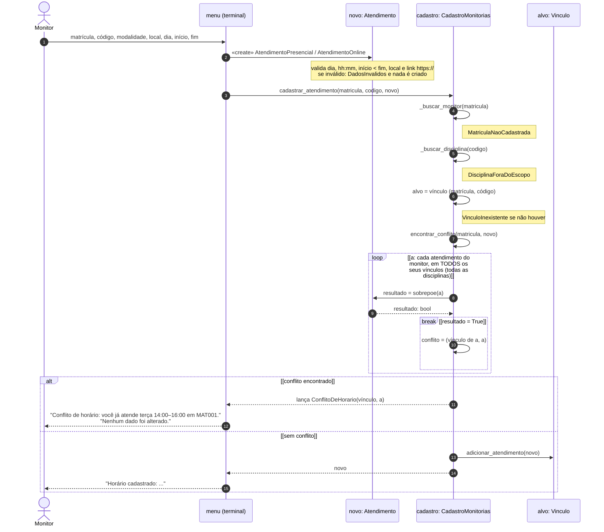

# Sequência revisada — F1: Cadastrar horário de atendimento

Fiel ao código de `CadastroMonitorias.cadastrar_atendimento` e `encontrar_conflito`
(`prototipo_monitoria/monitorias/dominio/cadastro.py`). Para exportar como imagem, cole o
bloco abaixo em https://mermaid.live e use "Export PNG/SVG". O GitHub também desenha o diagrama
direto nesta página.

## Diferenças em relação à entrega anterior

1. **O alcance do loop está explícito.** Antes, a guarda era `[a: cada atendimento]`, sem dizer
   de onde vinham os atendimentos. Agora o loop percorre **todos os atendimentos do monitor, em
   todas as disciplinas em que ele é vinculado**. Assim, um monitor que atende terça 14:00–16:00
   em MAT001 não consegue marcar terça 15:00–17:00 em DCC203. Também não consegue marcar na
   mesma disciplina, nem em outra modalidade.
2. **O conflito interrompe a verificação.** Antes, `sobrepoe(a)` voltava `True` com a anotação
   "divergência" e o loop seguia sem mostrar a consequência. Agora o fragmento `break` encerra o
   loop no primeiro conflito, e o `alt` mostra os dois desfechos: rejeição com
   `ConflitoDeHorario`, ou cadastro.
3. **O retorno é o resultado da chamada, não um valor fixo.** `sobrepoe(a)` devolve
   `resultado: bool`, e o valor `True` aparece só como condição do `break`.
4. **Nada é gravado antes de todas as verificações.** `adicionar_atendimento` só é chamado no
   ramo "sem conflito". Na rejeição, os atendimentos de todos os vínculos ficam como estavam.
5. **Os dados do horário são validados ao criar o objeto, antes do cadastro.** Formato, dia,
   início < fim e local são checados no construtor de `Atendimento`. Por isso a validação aparece
   antes de `cadastrar_atendimento`.

## Regra de sobreposição (`Atendimento.sobrepoe`)

Mesmo dia **e** `início_novo < fim_existente` **e** `início_existente < fim_novo`.

| Já cadastrado | Novo | Resultado |
|---|---|---|
| terça 14:00–16:00 | terça 15:00–17:00 | conflito (cruza) |
| terça 14:00–16:00 | terça 14:30–15:00 | conflito (contido) |
| terça 14:00–16:00 | terça 16:00–18:00 | aceito (só encosta) |
| terça 14:00–16:00 | quarta 14:00–16:00 | aceito (outro dia) |
| outro monitor, terça 14:00–16:00 | terça 15:00–17:00 | aceito (monitores diferentes) |

Testes que cobrem a regra:
- `test_atendimento.py`: classe `TestSobreposicao`.
- `test_cadastrar_atendimento.py`: `test_conflito_no_mesmo_vinculo`, `test_conflito_entre_disciplinas`, `test_conflito_entre_modalidades`, `test_horarios_podem_encostar_pelo_inicio`.
